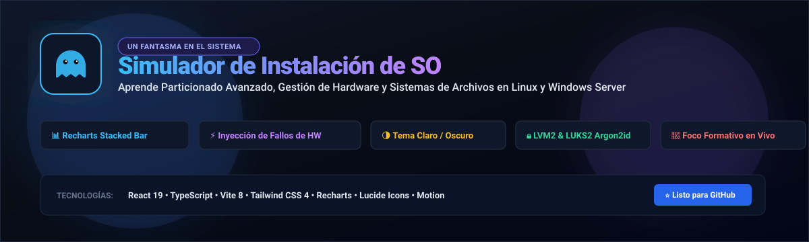
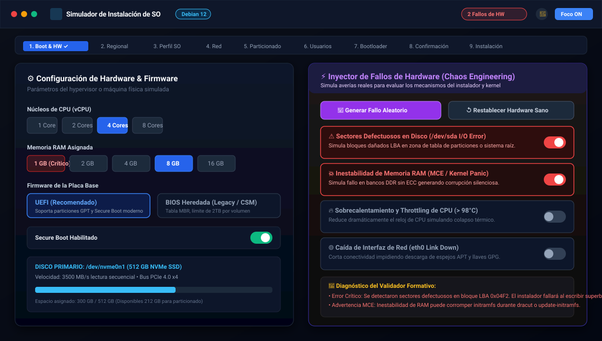
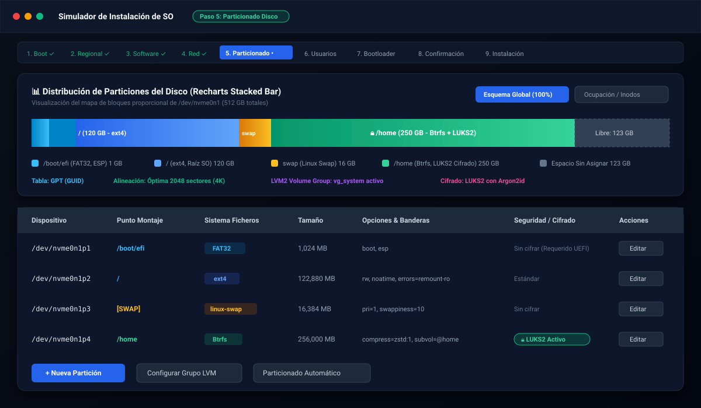
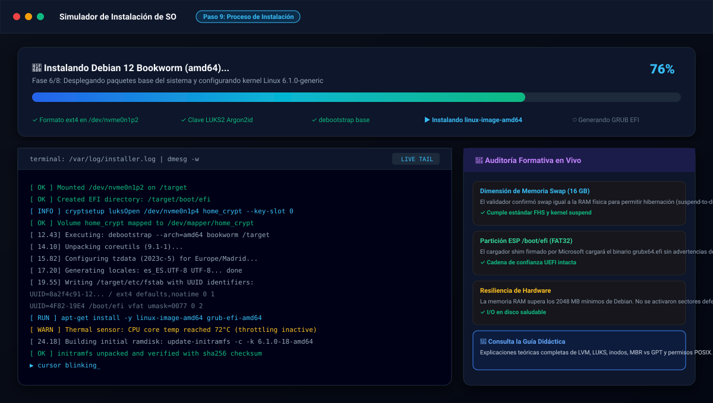
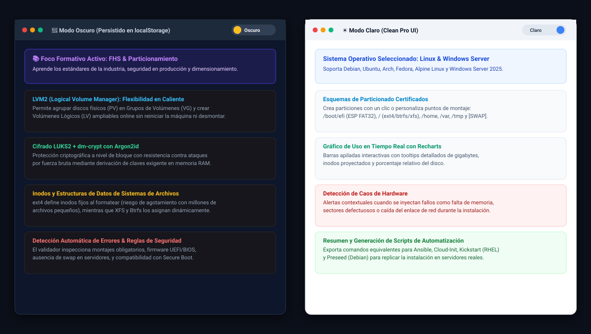

<div align="center">

  

  # 🖥️ Simulador de Instalación de Sistemas Operativos
  ### Entorno Formativo Interactivo para Linux & Windows Server

  <p align="center">
    <b>Aprende particionado avanzado, dimensionamiento de almacenamiento, firmware UEFI/BIOS, LVM2, cifrado LUKS2 y resiliencia frente a averías de hardware en tiempo real.</b>
  </p>

  <p align="center">
    <a href="#-vistas-del-simulador"></a>
    <a href="#-características-principales"></a>
    <a href="#-instalación-y-despliegue-rápido"></a>
    <a href="LICENSE"></a>
    
    
  </p>

</div>

---

## 📑 Tabla de Contenidos

1. [Acerca del Proyecto](#-acerca-del-proyecto)
2. [Vistas del Simulador](#-vistas-del-simulador)
   - [1. Configuración de Hardware & Inyector de Caos](#1-configuración-de-hardware--inyector-de-caos)
   - [2. Visualizador de Particionado con Recharts](#2-visualizador-de-particionado-con-recharts)
   - [3. Terminal de Instalación y Kernel Logs en Vivo](#3-terminal-de-instalación-y-kernel-logs-en-vivo)
   - [4. Comparativa de Temas (Claro / Oscuro) y Foco Formativo](#4-comparativa-de-temas-claro--oscuro-y-foco-formativo)
3. [Características Principales](#-características-principales)
4. [Estructura del Proyecto](#-estructura-del-proyecto)
5. [Instalación y Despliegue Rápido](#-instalación-y-despliegue-rápido)
6. [Tecnologías Utilizadas](#-tecnologías-utilizadas)
7. [Créditos y Licencia](#-créditos-y-licencia)

---

## 🎯 Acerca del Proyecto

El **Simulador de Instalación de Sistemas Operativos** es una aplicación web formativa de alto nivel diseñada para estudiantes, administradores de sistemas y profesionales DevOps. 

Permite experimentar sin riesgo de pérdida de datos con los 10 pasos fundamentales en la instalación de servidores y estaciones de trabajo:

```
[1. Boot & Hardware] ➔ [2. Regional] ➔ [3. Perfil SO] ➔ [4. Red] ➔ [5. Particionado]
       ➔ [6. Usuarios] ➔ [7. Bootloader] ➔ [8. Confirmación] ➔ [9. Instalación] ➔ [10. Primer Arranque]
```

Incorpora un **motor de auditoría y validación en tiempo real** que evalúa las decisiones del usuario (puntos de montaje, tamaños, tablas GPT vs MBR, ausencia de swap, compatibilidad con Secure Boot) y explica el *porqué* técnico de cada regla.

---

## 📸 Vistas del Simulador

> Las imágenes de esta sección son ilustraciones vectoriales (SVG) de cada pantalla, no capturas literales de la aplicación.

### 1. Configuración de Hardware & Inyector de Caos
Simula hypervisores (KVM/Proxmox/VMware) o hardware físico bare-metal. Incluye un módulo de **Chaos Engineering** para inducir sectores defectuosos, cortes de red, inestabilidad de memoria RAM (MCE) y estrangulamiento térmico (Thermal Throttling) para comprobar cómo reacciona el instalador y el kernel.

<div align="center">
  
</div>

---

### 2. Visualizador de Particionado con Recharts
Permite crear esquemas manuales o automáticos con soporte para **ext4, XFS, Btrfs, ReFS, Linux Swap, volúmenes lógicos LVM2 y cifrado completo de disco LUKS2 (Argon2id)**. Incluye un gráfico de barras apiladas interactivo generado con `recharts` que representa fielmente el porcentaje y la distribución espacial de los bloques de disco.

<div align="center">
  
</div>

---

### 3. Terminal de Instalación y Kernel Logs en Vivo
Observa la ejecución en tiempo real con una consola interactiva que reproduce trazas de `mkfs`, `fdisk`, `cryptsetup`, `debootstrap`, `apt`/`dnf`/`pacman` y mensajes del kernel `dmesg`.

<div align="center">
  
</div>

---

### 4. Comparativa de Temas (Claro / Oscuro) y Foco Formativo
La interfaz cuenta con un selector de tema (Modo Claro / Modo Oscuro) persistido en `localStorage` con soporte para preferencias del sistema operativo (`prefers-color-scheme`). Además, el panel lateral desplegable **Foco Formativo** ofrece explicaciones exhaustivas sobre estándares FHS, inodos, POSIX y arquitectura de sistemas de ficheros.

<div align="center">
  
</div>

---

## ⚡ Características Principales

- 🐧 **Dos perfiles de sistema operativo**:
  - **Linux**: particionado con ext4, XFS, Btrfs, swap, LVM2 y LUKS2. Los comandos de referencia siguen la familia RHEL (Rocky / Alma / Fedora: `dnf`, GRUB 2, `dracut`, NetworkManager).
  - **Windows Server 2025**: ESP + MSR + NTFS/ReFS, con script de `diskpart`, `DISM` y `bcdboot`.
  - *Aún no hay selector de distribución*: Debian, Ubuntu, Arch o Alpine solo aparecen como referencia en el contenido formativo.

- 📊 **Visualización de Almacenamiento con Recharts**:
  - Gráfico interactivo de barras apiladas horizontal (`Stacked Bar Chart`).
  - Identificación visual de cada punto de montaje (`/boot/efi`, `/`, `/home`, `/var`, `swap`).
  - Mapa visual del disco con modo de mapa de calor (datos calientes / templados / fríos).

- 💥 **Chaos Engineering & Detección de Averías**:
  - Botón *Generar Fallo Aleatorio* para ejercicios didácticos imprevistos.
  - Simulación de sectores defectuosos I/O en bloques LBA críticos.
  - Comprobación de RAM insuficiente según el SO (< 1 GB en Linux, < 2 GB en Windows Server) con avisos de OOM Killer.
  - Alertas automáticas integradas en el contador del validador de cabecera.

- 🔒 **Sistemas de Archivos y Seguridad Empresarial**:
  - Soporte de cifrado **LUKS2** con derivación de claves `Argon2id`.
  - Creación de Grupos de Volúmenes LVM2 y Volúmenes Lógicos redimensionables.
  - Montaje con opciones de rendimiento como `noatime` y explicación de cada sistema de archivos (CoW, compresión zstd de Btrfs, journaling de ext4/XFS).

- 📜 **Script equivalente y ficheros de configuración**:
  - El paso de confirmación genera el script de comandos que ejecutaría el instalador (`parted`, `cryptsetup`, LVM, `mkfs`, montaje, `chroot`, GRUB/systemd-boot) a partir de tu esquema real de particiones, o el script `diskpart`/`DISM`/`bcdboot` en Windows.
  - El paso de red genera la configuración equivalente para **Netplan**, **systemd-networkd**, **NetworkManager (keyfile)** y **PowerShell**.
  - ⚠️ Son scripts de referencia formativa: revísalos antes de ejecutarlos, porque borran el disco de destino.

- 🌓 **Selector de Tema Dinámico**:
  - Alternador de Modo Claro / Modo Oscuro en la cabecera.
  - Persistencia de preferencia en `localStorage`.
  - Transiciones suaves y contraste optimizado para entornos de aula y desarrollo.

---

## 📂 Estructura del Proyecto

```text
OS-Intall-Lab/
├── .github/
│   └── workflows/
│       └── ci.yml               # Integración continua (Bun: typecheck, tests y build)
├── docs/
│   └── screenshots/             # Capturas e ilustraciones vectoriales SVG
│       ├── banner.svg
│       ├── 01-hardware-chaos.svg
│       ├── 02-partitioning-recharts.svg
│       ├── 03-installation-terminal.svg
│       └── 04-theme-and-education.svg
├── public/
│   ├── icono.png                # Logotipo oficial "Un Fantasma en el Sistema"
│   ├── icono.svg                # Versión vectorial del logotipo
│   ├── log3.png
│   └── unfantasma-banner.png
├── src/
│   ├── components/
│   │   ├── Header.tsx           # Barra superior con selector de SO, tema y alertas
│   │   ├── GhostLogo.tsx        # Renderizado de marca con proporciones exactas
│   │   ├── HardwareBootStep.tsx # Paso 1: Configuración de hardware y firmware
│   │   ├── HardwareChaosInjector.tsx # Módulo de inyección de fallos aleatorios
│   │   ├── PartitioningStep.tsx # Paso 5: Gestor interactivo de particiones
│   │   ├── PartitionStackedBarChart.tsx # Gráfico de barras apiladas con Recharts
│   │   ├── VisualDiskLayout.tsx # Mapa visual de bloques y disco
│   │   ├── InstallingStep.tsx   # Paso 9: Terminal en vivo y simulación de kernel
│   │   └── EducationalDrawer.tsx# Panel formativo con teoría y buenas prácticas
│   ├── context/
│   │   └── ThemeContext.tsx     # Contexto de React para modo Claro/Oscuro
│   ├── types/
│   │   └── installer.ts         # Definiciones TypeScript de hardware, discos y validaciones
│   ├── utils/
│   │   ├── partitionValidator.ts# Motor de validación de reglas de particionado y hardware
│   │   ├── diskLayout.ts        # Traducción del esquema a particiones físicas, PV de LVM y nodos /dev
│   │   ├── installScript.ts     # Generador del script equivalente (Linux y Windows)
│   │   └── *.test.ts            # Tests unitarios con Vitest
│   ├── App.tsx                  # Componente raíz y máquina de estados del asistente
│   ├── main.tsx                 # Entrada de la aplicación React 19
│   └── index.css                # Estilos globales y utilidades de Tailwind CSS v4
├── .gitignore                   # Exclusiones de Git (node_modules, dist, etc.)
├── LICENSE                      # Licencia de código abierto MIT
├── bun.lock                     # Lockfile de dependencias (Bun)
├── package.json                 # Dependencias y scripts de ejecución
├── tsconfig.json                # Configuración de TypeScript
└── vite.config.ts               # Configuración de compilación con Vite
```

---

## 🚀 Instalación y Despliegue Rápido

### Requisitos Previos
- **Node.js**: v20.19 o superior (requisito de Vite 8)
- **Bun** (recomendado, el repositorio incluye `bun.lock`) o **npm** v10+

### Pasos de Instalación

1. **Clonar el repositorio**:
   ```bash
   git clone https://github.com/unfantasmaenelsistema/OS-Intall-Lab.git
   cd OS-Intall-Lab
   ```

2. **Instalar dependencias**:
   ```bash
   bun install
   ```
   Con npm también funciona (`npm install`), pero las versiones no quedarán fijadas por `bun.lock`.

3. **Iniciar el servidor de desarrollo local**:
   ```bash
   npm run dev
   ```
   Abre tu navegador en `http://localhost:3000`.

4. **Verificar tipos, ejecutar los tests y compilar para producción**:
   ```bash
   npm run lint
   npm run test
   npm run build
   ```

5. **Previsualizar la compilación de producción**:
   ```bash
   npm run preview
   ```

---

## 🛠️ Tecnologías Utilizadas

| Categoría | Tecnología | Versión | Propósito |
| :--- | :--- | :--- | :--- |
| **Framework UI** | [React](https://react.dev/) | `^19.0.1` | Renderizado declarativo con componentes modernos |
| **Lenguaje** | [TypeScript](https://www.typescriptlang.org/) | `^7.0.2` | Tipado estático robusto para arquitecturas complejas |
| **Bundler** | [Vite](https://vitejs.dev/) | `^8.3.0` | Empaquetado ultrarrápido y desarrollo ágil |
| **Estilos** | [Tailwind CSS](https://tailwindcss.com/) | `^4.3.3` | Diseño responsive moderno y paletas dark/light |
| **Gráficos** | [Recharts](https://recharts.org/) | `^3.10.1` | Gráficos de barras apiladas SVG para particionado |
| **Iconografía** | [Lucide React](https://lucide.dev/) | `^0.546.0` | Iconos vectoriales limpios y coherentes |
| **Animaciones** | [Motion](https://motion.dev/) | `^12.23.24` | Transiciones fluidas entre pasos y notificaciones |
| **Tests** | [Vitest](https://vitest.dev/) | `^5.0.4` | Tests unitarios del validador y del generador de scripts |
| **CI / CD** | GitHub Actions + Bun | `v4` | Typecheck, tests y build en cada push / PR |

---

## 👤 Créditos y Licencia

Creado y desarrollado con fines formativos para **Un Fantasma en el Sistema**.

Este proyecto se distribuye bajo la licencia **MIT**. Consulta el archivo [LICENSE](LICENSE) para más detalles.

<div align="center">
  <sub>Hecho con pasión por los sistemas operativos y la educación tecnológica.</sub>
</div>
